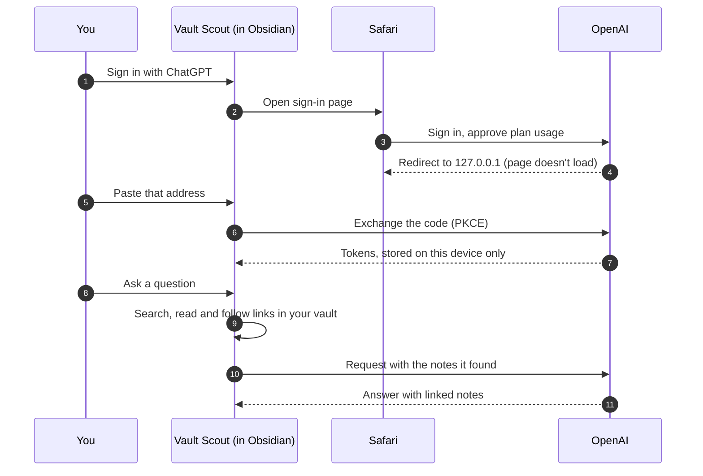

<h1 align="center">🔭 Vault Scout</h1>

<p align="center">
  <b>Research your Obsidian vault with ChatGPT – on your iPhone.</b><br>
  Ask questions, let the agent search and read your notes, and have it write new ones.<br>
  Paid for by your ChatGPT plan, not an API key.
</p>

<p align="center">
  
  
  
  
  <a href="LICENSE"></a>
</p>

<p align="center">
  <a href="#install">Install</a> ·
  <a href="#quickstart-on-your-iphone">Quickstart</a> ·
  <a href="#what-it-can-do">Features</a> ·
  <a href="#skills">Skills</a> ·
  <a href="#privacy-and-network-use">Privacy</a> ·
  <a href="#faq">FAQ</a>
</p>

<table align="center">
  <tr>
    <td width="50%"></td>
    <td width="50%"></td>
  </tr>
  <tr>
    <td><sub><b>Ask on your phone.</b> "Create a quick demo view with Prism", then "Make a 3D view". The agent writes the note and checks that Prism renders it.</sub></td>
    <td><sub><b>The note it wrote</b>, rendered by <a href="https://github.com/floorianmb/prism-viz">Prism</a>: an interactive 3D chart you can orbit with a finger.</sub></td>
  </tr>
</table>

<p align="center"><sub>Real screenshots from the Obsidian iOS app.</sub></p>

---

Your notes sync to your phone. Your thinking partner should come with them. Vault Scout puts a research agent inside the Obsidian app on iOS. It searches your vault, reads the notes that matter, follows links and backlinks, and answers with citations you can tap. When you ask it to, it writes notes too, and only after you approve each change.

It runs entirely inside the Obsidian app. There is no server in between and no API key, and you don't need a computer. You sign in with ChatGPT once, and requests count against your **ChatGPT Plus or Pro** plan through OpenAI's [Sign in with ChatGPT](https://developers.openai.com/siwc/token-sharing-open-source) for open-source apps.

## Why Vault Scout?

- **📱 Phone first.** It was built and tested in the Obsidian iOS app: a full-screen chat tab, a keyboard that gets out of your way, and a layout that leaves room for Obsidian's navigation bar.
- **💳 Your plan, not your credit card.** No API billing and no keys to paste. You set a weekly limit for Vault Scout in your ChatGPT settings, and that is it.
- **🔎 Answers from your notes.** The agent sees your folder structure and root index up front, tries several keywords and the languages your notes are written in, reads what it needs (several notes at once) and links every note it relies on.
- **✍️ Writes only with your OK.** New notes, edits, properties and renames are shown as a diff first. Nothing is written until you tap *Apply*.
- **📸 Show it, select it.** Attach photos or screenshots from your camera roll, or select a passage in a note and ask about just that.
- **🧩 Skills like on desktop agents.** Install the [Prism](https://github.com/floorianmb/prism-viz) skill with one tap, and the agent builds interactive charts, diagrams and dashboards in your notes and checks that they render.
- **🗂️ Chats are notes.** Every conversation is saved as a Markdown note, syncs with your vault, and can be picked up again on any device.

## Install

> Vault Scout is not in the community plugin directory yet. The steps below work once the first release is published.

**With [BRAT](https://github.com/TfTHacker/obsidian42-brat)** (works on iPhone and iPad)
1. In Obsidian on your iPhone, open *Settings → Community plugins*, turn off *Restricted mode*, then browse for **BRAT**, install it and enable it.
2. Run *BRAT: Add a beta plugin for testing* from the command palette and enter `floorianmb/vault-scout`.
3. Enable **Vault Scout** under *Settings → Community plugins*.

**Manually**
Copy `main.js`, `manifest.json` and `styles.css` from the [latest release](https://github.com/floorianmb/vault-scout/releases/latest) into `<vault>/.obsidian/plugins/vault-scout/`. If your vault syncs (Obsidian Sync with *Installed community plugins* on, or iCloud), the plugin reaches your iPhone by itself. Restart Obsidian there and enable it.

**Requirements:** Obsidian 1.13 or later and a ChatGPT **Plus or Pro** plan. Free accounts can sign in, but cannot use plan usage.

## Quickstart on your iPhone

1. **Open the chat:** *Settings → Vault Scout → Open chat*, or *Vault Scout: Open chat* from the command palette. It opens as its own tab.
2. **Sign in:** tap *Sign in with ChatGPT*, then *Open sign-in page*. Sign in and approve Vault Scout, including **plan usage**.
3. **Copy the address of the page that doesn't load.** After you approve, Safari shows *"Safari can't connect to the server"*. That page is expected: the sign-in code is in its address. Tap the address bar, copy the whole address and switch back to Obsidian.
4. **Paste it.** Use *Paste*, or long-press the field. Vault Scout connects as soon as the address is complete and the keyboard closes. If iOS reloads Obsidian in the meantime, the sign-in waits for up to 30 minutes.
5. **Ask something.** For example: *"What did we decide about the onboarding flow?"* or *"Summarize my notes on pricing and create a new overview note."*



Why the copy-and-paste step? Sign in with ChatGPT sends the browser back to a small server on `127.0.0.1`, and an Obsidian plugin can't run one on iOS. Copying the address carries the one-time code over by hand. The code is useless without a secret that never leaves the plugin (PKCE).

## What it can do

| | |
|---|---|
| **Search** | Full-text search over your notes, with folder and tag filters. Results include frontmatter title, description and type plus matching snippets. If no note contains every word, it falls back to the best partial matches. |
| **Read and follow** | Reads notes (long ones in chunks), lists folders, and follows outgoing links and backlinks. Several reads run in parallel. |
| **Cite** | Every note it relies on is linked in the answer. Tap a link to open the note. |
| **Write, with approval** | `create_note`, `edit_note` (replaces one exact passage) and `append_to_note`. You see a diff and tap *Apply* or *Reject*. Hidden folders and the Obsidian configuration are off limits. |
| **Properties** | `get_properties` and `set_properties` read and change frontmatter through Obsidian's own frontmatter API, without touching the note's text. `null` removes a property. You approve the before and after. |
| **Rename and move** | `rename_file` renames a note or moves it to another folder, after you approve it. Obsidian updates every link to it. The file extension stays the same. Nothing is ever deleted. |
| **Ask you** | When something is unclear, for example which of two notes you mean, the agent asks with `ask_user`, with suggested answers as buttons, instead of guessing. |
| **Selection** | Select text in a note and run *Ask about the selection* (command palette or the editor menu). The question is scoped to that passage, and edits stay inside it unless you ask for more. |
| **Images** | Tap the image button next to the input to attach up to four photos or screenshots. They are scaled down on the device before they are sent. |
| **Check Prism blocks** | After writing a ` ```viz ` block, it opens the note so [Prism](https://github.com/floorianmb/prism-viz) renders it, reads Prism's error log and fixes what broke. |
| **Remember** | Chats are notes in `Vault Scout/Chats/`. Open an earlier one from the history button and continue where you left off, also on another device. |
| **Pick the model** | The model menu lists the models your ChatGPT account can use. |

## Skills

Skills are instructions the agent loads when a task needs them. They use the same `SKILL.md` format as skills for Claude Code and Codex, and live in your vault under `Vault Scout/Skills/`, so they sync to every device.

- **Install on your phone:** *Settings → Vault Scout → Install skills*.
  - **prism** with one tap: interactive charts, diagrams, dashboards and formulas with the Prism plugin.
  - **okf-notes**: notes that follow the [Open Knowledge Format](https://github.com/GoogleCloudPlatform/open-knowledge-format) (OKF 0.2), with your vault's own `AGENTS.md` or `CLAUDE.md` taking precedence.
  - **Any GitHub folder** that contains a `SKILL.md`. Paste its link.
- **Manage them:** turn each skill on or off, update it from where it came from, or move it to the trash.
- **Efficient:** the agent only sees skill names and descriptions until it needs one. A loaded skill stays loaded for the rest of the chat. A skill can list vault files in `vault-scout-context` that load along with it.
- **Built for a phone:** skills written for terminal agents often call scripts. Vault Scout tells the agent to use its own tools instead, for example `check_prism` instead of Prism's command-line render.

On a Mac you can also import the skills you already use with Claude Code and Codex.

## Privacy and network use

- **What goes to OpenAI:** your messages, attached images, and the content of the notes the agent reads or writes, sent to `api.openai.com` under your ChatGPT account. OpenAI's terms for Sign in with ChatGPT apply. Requests are made with `store: false`.
- **Your sign-in stays on the device.** Tokens are kept in Obsidian's secret storage on the device (*Settings → Keychain*). They are never written to the vault or plugin settings, so they never sync. Each device signs in separately. *Sign out* revokes the session.
- **Images are not saved.** A chat note records that an image was attached, not the image itself.
- **Nothing else is contacted**, except GitHub (`api.github.com`, `raw.githubusercontent.com`) when you install or update a skill. There is no analytics or telemetry, and no server of ours.
- **Your vault is the only storage.** Chats are notes and skills are files, all in your vault and under your control. Settings (model, folders, skill switches) are in the plugin's `data.json`.

## Good to know

- **Answers arrive at once on iOS.** On the iPhone each step of the agent appears live (*Searching …*, *Reading …*), but the text of an answer shows up when it is complete, not word by word. OpenAI's successful plan-usage responses carry no CORS header, so the iOS web view can't read them as a stream. The Obsidian desktop app streams word by word.
- **Keep Obsidian open while it works.** iOS pauses apps in the background, which interrupts a running answer.
- **Weekly limit reached?** You set the limit per app in ChatGPT's settings. Vault Scout shows a message when it is used up and never switches to paid API billing.

## FAQ

**Does this cost API credits?**
No. Requests use the allowance of your ChatGPT Plus or Pro plan. There is no API key and no API billing.

**Can it change or delete my notes behind my back?**
No. Every change, including a rename or move, is shown for approval first (*Settings → Confirm changes*). There is no tool for deleting notes.

**Why do I sign in again on my iPad?**
Sign-ins are per device on purpose. OpenAI replaces the refresh token on every refresh, so a synced session would keep logging your devices out of each other.

**Do I need a Mac or a server?**
No. Everything runs in the Obsidian app on your iPhone or iPad.

## How it works

- **Sign in with ChatGPT, plan usage for open-source apps.** OAuth 2.0 with PKCE and dynamic client registration (`dynamic_agent_client`), plus a per-device `ext_agent_host_id`. ID token claims (`iss`, `aud`, `nonce`, `sub`) are checked. The token comes straight from the token endpoint over TLS (OIDC Core 3.1.3.7).
- **Responses API with `stream: true` and `store: false`, as plan usage requires.** On mobile the event stream is read in one piece through Obsidian's `requestUrl`. The desktop app streams through Node's `https` module, since the web view blocks `fetch` for these responses.
- **Client-side history.** With `store: false`, every request resends the conversation. Reasoning carries over as `encrypted_content`. Older tool results are shortened so long chats stay within the context window.
- **Linted with the official [`eslint-plugin-obsidianmd`](https://github.com/obsidianmd/eslint-plugin)** recommended config, with no warnings.

## Development

```sh
npm install
npm run build              # type check and bundle main.js
npm run lint               # official Obsidian lint rules
npm run deploy -- <vault>  # copy the build into <vault>/.obsidian/plugins/vault-scout
```

`skills/` contains the skills offered under *Install skills*, installed from this repository.

## Acknowledgements

Several features are ideas from **[Chatting with AI](https://github.com/o1xhack/obsidian-chatting)** by [o1xhack](https://github.com/o1xhack), itself based on [obsidian-chat](https://github.com/omarshahine/obsidian-chat) by [Omar Shahine](https://github.com/omarshahine) (both MIT). Thank you! Chatting with AI is a mobile-friendly vault agent that also supports Anthropic and OpenAI API keys. Have a look at it.

Adapted from it: keeping sign-in credentials in Obsidian's SecretStorage, the frontmatter tools `get_properties` and `set_properties`, `ask_user`, scoping a question to the editor selection, image attachments, and `rename_file`. Vault Scout implements them on its own and adds approval to every change. No code was copied.

## License

[MIT](LICENSE) © floorianmb
